# 🐾 Animalia Pet Care — UI/UX Guide & Visual Documentation

> **Language:** Hinglish (Hindi + English)  
> **Project:** Animalia Pet Care (Grooming Clinic, Hospital & Pet Store — Rewari)  
> **Tech Stack:** Next.js 16 (App Router), React 19, Tailwind CSS v4, Framer Motion, Lucide Icons  
> **Target Audience:** Developers, Designers, Store Owners aur End-Users jo application ke design, UX flows aur customer touchpoints ko detail me samajhna chahte hain.

---

## 📑 Table of Contents (Index)

1. [🎨 Design Philosophy & Theme System](#1--design-philosophy--theme-system)
2. [🧭 Top Announcement Bar & Sticky Navbar](#2--top-announcement-bar--sticky-navbar)
3. [✨ Hero Section ("Paws, Bubbles & Bahut Saara Pyaar")](#3--hero-section-paws-bubbles--bahut-saara-pyaar)
4. [🏷️ Trust Strip & Certified Quality Badges](#4--trust-strip--certified-quality-badges)
5. [✂️ Services Showcase Section](#5--services-showcase-section)
6. [💰 Transparent Pricing Calculator & Weight-Based Plans](#6--transparent-pricing-calculator--weight-based-plans)
7. [⭐ Google Reviews & Wall of Love (Social Proof)](#7--google-reviews--wall-of-love-social-proof)
8. [🪄 Interactive Write Review Stepper (Review Flow)](#8--interactive-write-review-stepper-review-flow)
9. [🛍️ The Groomer's Shelf & WhatsApp Commerce Basket](#9--the-groomers-shelf--whatsapp-commerce-basket)
10. [🔄 Before & After Transformations Gallery](#10--before--after-transformations-gallery)
11. [🌱 The Fear-Free Journey (How It Works)](#11--the-fear-free-journey-how-it-works)
12. [🧑‍⚕️ Meet The Groomers & Medical Team](#12--meet-the-groomers--medical-team)
13. [❓ FAQ Accordion (Frequently Asked Questions)](#13--faq-accordion-frequently-asked-questions)
14. [📅 30-Second Quick Appointment Booking Form](#14--30-second-quick-appointment-booking-form)
15. [📍 Location, Map & Directions (Rewari Centre)](#15--location-map--directions-rewari-centre)
16. [📱 In-Store Counter QR Code Standee (`/review-qr`)](#16--in-store-counter-qr-code-standee-review-qr)
17. [📲 Mobile Responsive Experience & Sticky Bottom Bar](#17--mobile-responsive-experience--sticky-bottom-bar)
18. [🎯 Key UX Takeaways & Conversion Checklist](#18--key-ux-takeaways--conversion-checklist)

---

## 1. 🎨 Design Philosophy & Theme System

Hamara UI design **"Warm, Playful yet Clinically Trustworthy"** vibe deliver karta hai. Pet parents anxious hote hain jab wo apne pet ko grooming ya treatment ke liye chodte hain, isliye design me friendly Neo-Brutalist "Sticker & Fur" theme use kiya gaya hai.

### 🌟 Key Design Tokens:
* **Background Tone:** `#FFFDF9` (Cream) — Aankhon ko thandak dene wala warm organic canvas, rigid pure white nahi.
* **Primary Brand Tone:** `#0F766E` (Peacock Green) — Medical cleanliness, calm nature aur trust ko represent karta hai.
* **Accent Call-To-Action:** `#FFB703` (Marigold Yellow) — Energetic, warm sunshine feel deta hai jo clicks aur conversions badhata hai.
* **Secondary Alert/Badges:** `#E63946` (Chilli Red) — Offers, notification counts aur emergency helpline ke liye.
* **Dark Contrast:** `#1A202C` (Deep Ink) — Soft readable black jisme 2px / 2.5px solid borders aur sticker-shadows (`box-shadow: 4px 4px 0px #1A202C`) create kiye gaye hain.
* **Mascots:** 
  * 🐶 **Bruno The Dog:** Shower cap pehne playful dog mascot.
  * 🐱 **Mishti The Cat:** Bubble tub me relax karti cat mascot.

---

## 2. 🧭 Top Announcement Bar & Sticky Navbar

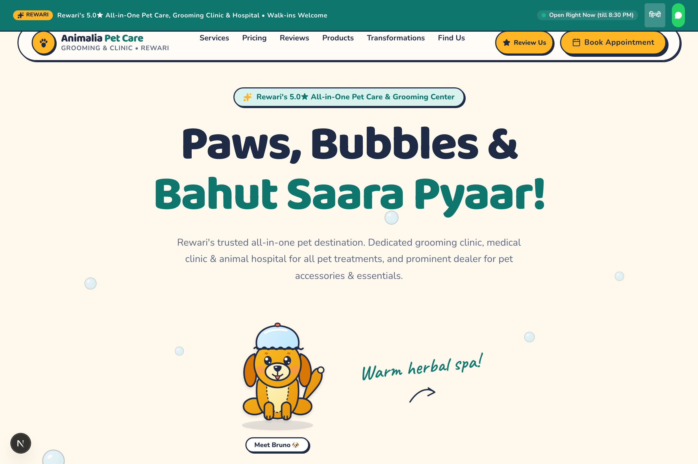

### 🔍 UI/UX Explanation (Hinglish):
1. **Live Operational Status (Real-time Clock):**
   * Top bar me live green pulsing dot ke sath dikhta hai: `● Open Right Now (till 8:30 PM)`.
   * Yeh local time check karke dynamically open ya closed state show karta hai, jisse customers ko phone karne se pehle clarity mil jati hai.
2. **Bilingual Language Toggle (English ⇄ हिन्दी):**
   * Rewari aur Haryana region ke customers ki convenience ke liye one-click language switcher diya gaya hai. Ispe click karte hi content easily translate ho jata hai.
3. **Emergency Floating WhatsApp Pill:**
   * Top right me direct WhatsApp CTA diya gaya hai emergency queries ya walk-in coordination ke liye.
4. **Sticker Style Brand Navbar:**
   * Logo me yellow circle paw icon aur bold typography hai: `Animalia Pet Care - Grooming & Clinic • Rewari`.
   * Desktop menu items: *Services, Pricing, Reviews, Products, Transformations, Find Us*.
   * Two high-contrast Action Buttons:
     * `⭐ Review Us` (Instant Google review flow trigger)
     * `📅 Book Appointment` (Direct anchor to 30-second form)

---

## 3. ✨ Hero Section ("Paws, Bubbles & Bahut Saara Pyaar")

### 🔍 UI/UX Explanation (Hinglish):
* **Catchy Hinglish Headline:** *"Paws, Bubbles & Bahut Saara Pyaar!"* — Pet owners ke dil se connect karne ke liye local friendly tone use kiya hai.
* **Trust Chip:** `✨ Rewari's 5.0★ All-in-One Pet Care & Grooming Center` — Top pill card instant credibility establish karta hai.
* **Value Proposition Subtitle:** Clear text me bataya gaya hai ki ye sirf ek salon nahi hai, balki:
  1. Dedicated grooming clinic
  2. Full medical clinic & animal hospital for all treatments
  3. Prominent dealer for pet accessories & food essentials.
* **Interactive Bruno Mascot:** Bruno puppy animated bubble ke beech bath cap pehankar khada hai. User cursor hover ya tap karke cute reactions dekh sakta hai.

---

## 4. 🏷️ Trust Strip & Certified Quality Badges

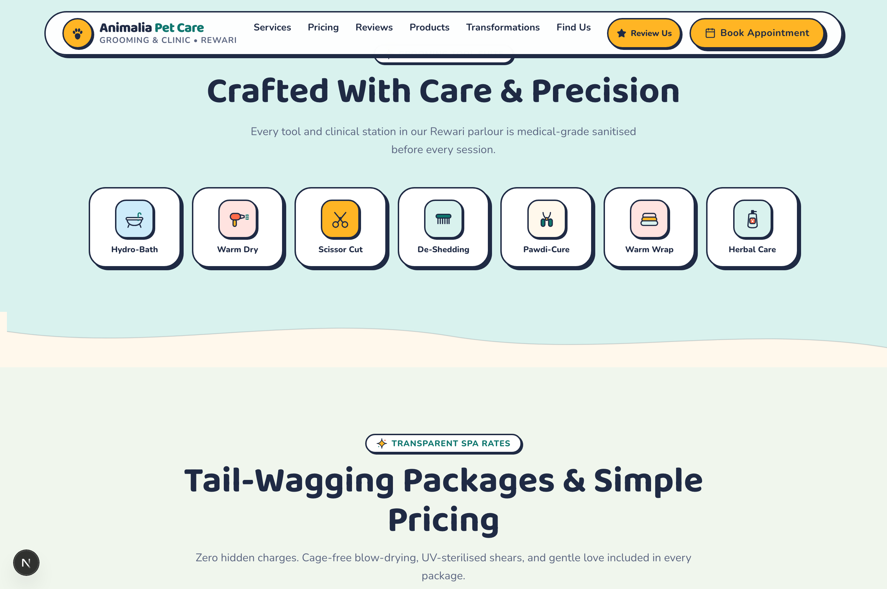

### 🔍 UI/UX Explanation (Hinglish):
* User jab hero section se scroll down karta hai, to use **5 Key Hygiene & Care Badges** dikhte hain:
  1. **Hydro-Bath:** Deep cleansing warm water jet circulation.
  2. **Warm Dry:** Low-speed, sound-dampened pet blowers (cage-free!).
  3. **Scissor Cut:** Hand-styled breed specific cuts.
  4. **De-Shedding:** Professional undercoat deshedding tools.
  5. **Pawdi-Cure:** Gentle nail trimming and herbal paw wax massage.
* **Medical Sanitisation Note:** *"Every tool and clinical station in our Rewari parlour is medical-grade sanitised before every session."* — Infection ya ticks transfer hone ka fear 100% remove hota hai.

---

## 5. ✂️ Services Showcase Section

### 🔍 UI/UX Explanation (Hinglish):
* **Category Tabs (Dog Spa vs Cat Spa):** Dog aur Cat dono ke alag-alag specific requirements hote hain, isliye users tab switch karke specific packages dekh sakte hain.
* **Visual Card Badges:** Har service card me duration (e.g. 45 mins, 90 mins), gentle handling guarantee, aur included items bullet points me listed hain.
* **Direct Booking CTA:** Har card ke bottom par direct WhatsApp booking link diya gaya hai jo message me automatically service name pre-fill kar deta hai.

---

## 6. 💰 Transparent Pricing Calculator & Weight-Based Plans

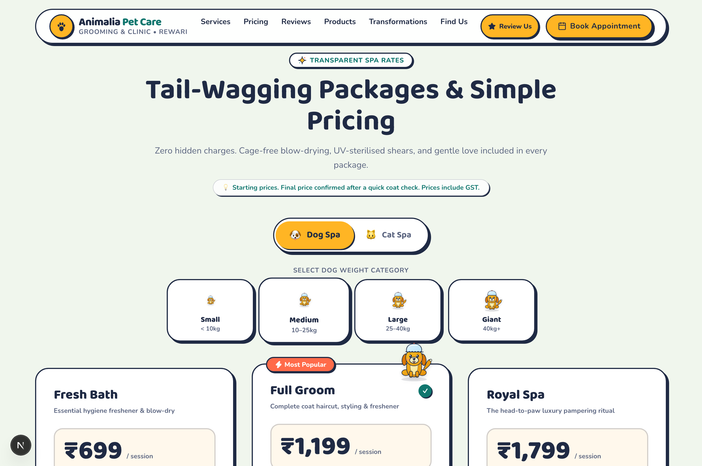

### 🔍 UI/UX Explanation (Hinglish):
* **Zero Hidden Charges Banner:** *"Zero hidden charges. Cage-free blow-drying, UV-sterilised shears, and gentle love included in every package."*
* **Dog Weight Selector (Interactive Pill Buttons):**
  * `Small (< 10kg)` (e.g., Shih Tzu, Pug, Pomeranian)
  * `Medium (10–25kg)` (e.g., Beagle, Cocker Spaniel, Indie)
  * `Large (25–40kg)` (e.g., Golden Retriever, Labrador, GSD)
  * `Giant (40kg+)` (e.g., Saint Bernard, Great Dane, Rottweiler)
* **Pricing Cards:**
  1. **Fresh Bath (₹699):** Essential hygiene freshener, tearless herbal shampoo, nail clip, ear clean, blow-dry.
  2. **Full Groom (₹1,199 — Marked as "Most Popular"):** Haircut & styling, sanitary trim, blueberry facial, paw balm.
  3. **Royal Spa (₹1,799):** Aroma bath, deep de-shedding spa, dental clean, anti-tick coat shield, festive ribbon bandana.
* **Notice Tag:** *"Starting prices. Final price confirmed after a quick coat check. Prices include GST."* — Complete transparency.

---

## 7. ⭐ Google Reviews & Wall of Love (Social Proof)

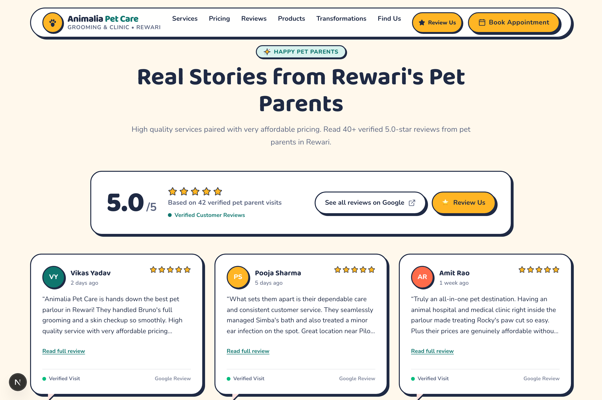

### 🔍 UI/UX Explanation (Hinglish):
* **Live Score Card:** `5.0 / 5 ★★★★★` badge based on 42+ verified local pet parent visits in Rewari.
* **Dual Action Buttons:**
  * `See all reviews on Google ↗` (External link to verified Google Maps page).
  * `⭐ Review Us` (Seedha hamara interactive review assistant open karta hai).
* **Testimonial Cards:** Real Rewari locals ke reviews display kiye gaye hain:
  * **Vikas Yadav:** *"Animalia Pet Care is hands down the best pet parlour in Rewari... High quality service with very affordable pricing."*
  * **Pooja Sharma:** *"What sets them apart is dependable customer service... treated a minor ear infection on the spot near Pilot Chowk."*
  * **Amit Rao:** *"Truly an all-in-one pet destination. Having an animal hospital right inside makes treating minor cuts so easy."*

---

## 8. 🪄 Interactive Write Review Stepper (Review Flow)

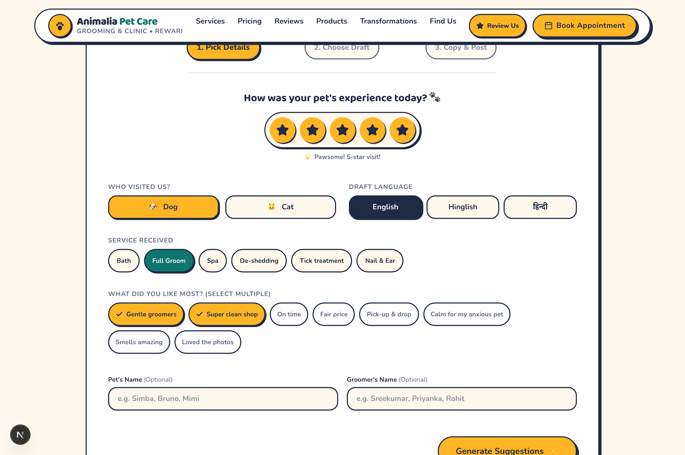

### 🔍 UI/UX Explanation (Hinglish):
Yeh project ka sabse powerful **Growth & Local SEO feature** hai! Aksar customers Google par review likhte waqt sochte hain ki kya likhein. Yeh stepper unka kaam 10 seconds me complete kar deta hai:

* **Step 1: Star Experience Rating:** 1 se 5 stars click karne ka option. 5 stars select hote hi confetti aur *"Pawsome 5-star visit!"* message appear hota hai.
* **Step 2: Details Selection (Zero Typing needed):**
  * **Who visited?** `🐶 Dog` ya `🐱 Cat`
  * **Draft Language:** `English`, `Hinglish`, ya `हिन्दी`
  * **Service Received:** *Bath, Full Groom, Spa, De-shedding, Tick treatment, Nail & Ear*
  * **What did you like most?** Multi-select pill chips (*Gentle groomers, Super clean shop, On time, Fair price, Pick-up & drop, Calm for anxious pet, Smells amazing*).
  * **Optional Fields:** Pet ka naam (e.g. Simba, Bruno) aur Groomer ka naam.
* **Step 3: Magic Suggestion & 1-Click Copy:**
  * AI/Template based natural review generate hota hai.
  * Customer `Copy Review & Open Google Maps` click karta hai -> Review clipboard me copy ho jata hai aur seedha Google Maps review box open ho jata hai. Sirf Paste & Submit karna hota hai!

---

## 9. 🛍️ The Groomer's Shelf & WhatsApp Commerce Basket

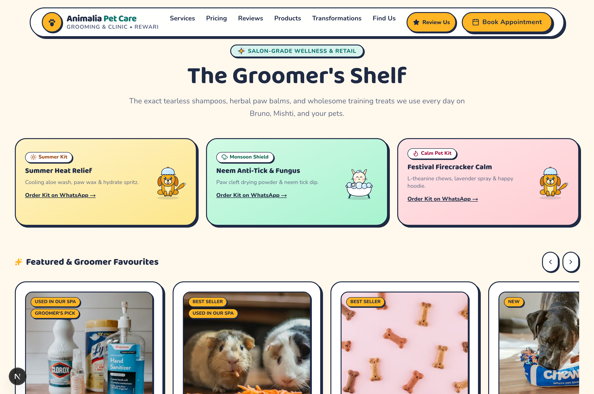

### 🔍 UI/UX Explanation (Hinglish):
* **Curated Salon-Grade Retail:** E-commerce store jaha sirf random products nahi, balki salon me use hone wale tested essentials beche jaate hain.
* **Seasonal Kits Highlighted:**
  * ☀️ **Summer Heat Relief Kit:** Cooling aloe wash, paw wax, hydrate spritz.
  * 🌧️ **Monsoon Shield Kit:** Paw cleft drying powder, neem anti-tick dip.
  * 🎆 **Festival Firecracker Calm Kit:** L-theanine treats, lavender calming spray, happy hoodie.
* **Add to Basket Experience:**
  * Card par click karne se **Quick View Modal** khulta hai with complete ingredient details.
  * "Add to Basket" click karne par **Floating Paw Animation (`🐾 +1`)** bounce hoti hai.
  * Screen ke bottom right corner me floating **Basket Pill** appear hoti hai with total item count aur INR price.
* **Slide-over Basket Drawer:**
  * Customer quantity increase/decrease kar sakta hai.
  * Fulfillment selection: `In-Store Pickup (Ready in 30 mins)` vs `Express Delivery in Rewari`.
  * **"Order via WhatsApp" Button:** Pura formatted cart list WhatsApp chat me send ho jata hai bina kisi complicated payment gateway ke!

---

## 10. 🔄 Before & After Transformations Gallery

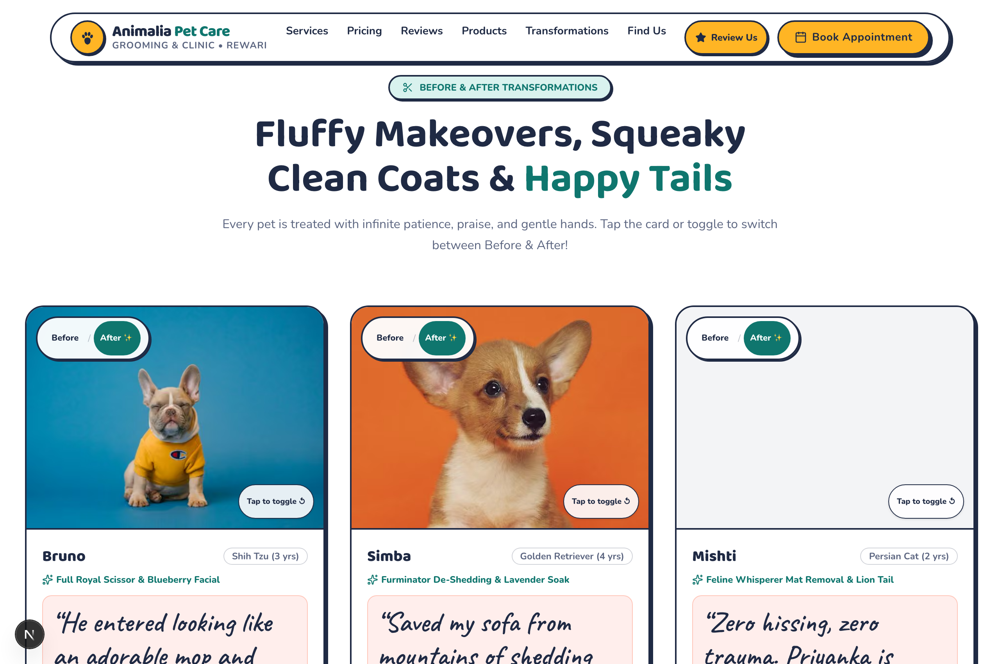

### 🔍 UI/UX Explanation (Hinglish):
* **Interactive Flip / Toggle Button:** Har pet card ke top par `Before / After ✨` switcher aur `Tap to toggle` button diya gaya hai.
* **Visual Proof Cards:**
  * **Bruno (Shih Tzu, 3 yrs):** Tangled messy fur se lekar Royal Scissor Cut & Blueberry Facial transformation.
  * **Simba (Golden Retriever, 4 yrs):** Heavy shedding coat se lekar Furminator Lavender Soak fresh shine.
  * **Mishti (Persian Cat, 2 yrs):** Zero trauma gentle mat removal & lion tail trim.
* **Parent Testimonial Quotes:** Har card ke bottom par handwritten font me pet parents ka genuine reaction highlight hota hai.

---

## 11. 🌱 The Fear-Free Journey (How It Works)

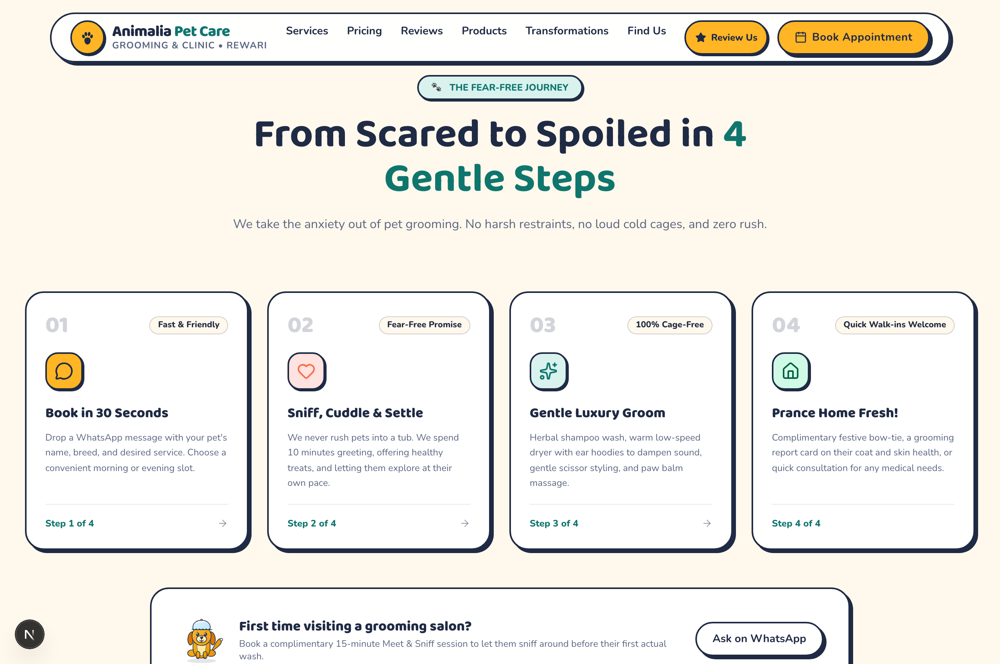

### 🔍 UI/UX Explanation (Hinglish):
Pet parents ko grooming session ka pura step-by-step process samjhane ke liye 4 gentle steps display kiye gaye hain:
1. **Step 01 — Book in 30 Seconds:** WhatsApp par convenient morning ya evening slot pick karein.
2. **Step 02 — Sniff, Cuddle & Settle:** Ham pets ko seedha tub me nahi daalte. 10 minutes treat khilakar unhe relax karte hain.
3. **Step 03 — Gentle Luxury Groom:** Herbal shampoo, low-noise blowers aur warm paw balm massage.
4. **Step 04 — Prance Home Fresh!:** Free festive bow-tie bandana aur pet health report card ke sath khush hokar ghar rawana.
* **First-timer reassurance banner:** Naye pet parents ke liye free 15-minute "Meet & Sniff" orientation booking ka CTA diya gaya hai.

---

## 12. 🧑‍⚕️ Meet The Groomers & Medical Team

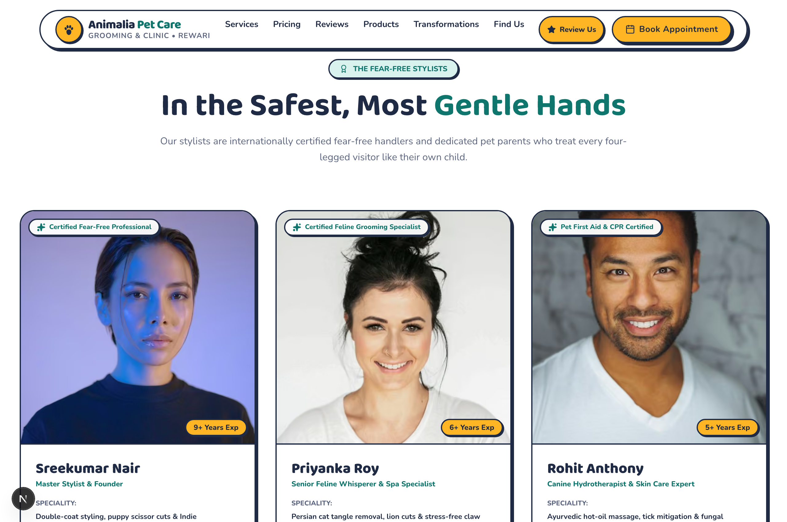

### 🔍 UI/UX Explanation (Hinglish):
* Anonymous parlour ki jagah certified human experts dikhaye gaye hain:
  * **Sreekumar Nair (9+ Years Exp):** *Master Stylist & Founder* — Certified Fear-Free Professional, puppy scissor cuts specialist.
  * **Priyanka Roy (6+ Years Exp):** *Senior Feline Whisperer* — Persian cat stress-free grooming & lion cuts specialist.
  * **Rohit Anthony (5+ Years Exp):** *Canine Hydrotherapist* — Ayurvedic warm-oil massages aur tick/fungal treatments expert.
* Har specialist ke top par verification badge hai jo professional credibility build karta hai.

---

## 13. ❓ FAQ Accordion (Frequently Asked Questions)

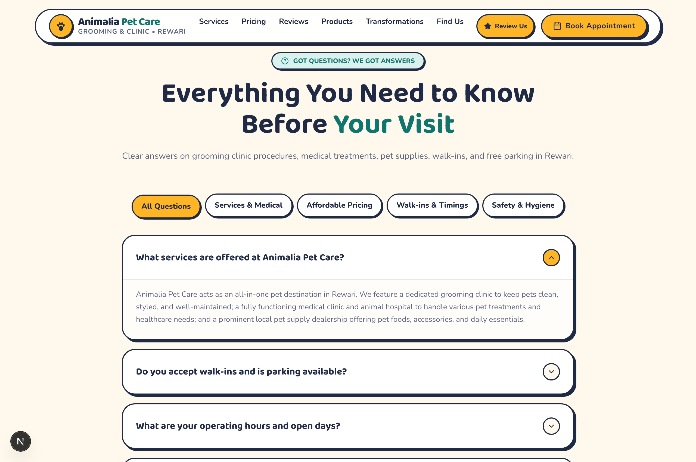

### 🔍 UI/UX Explanation (Hinglish):
* **Filter Category Pills:**
  * *All Questions*
  * *Services & Medical*
  * *Affordable Pricing*
  * *Walk-ins & Timings*
  * *Safety & Hygiene*
* **Smooth Accordion Interactions:** Click karte hi question expand hota hai with clear, polite answers. Anxious questions jaise *"Kya aap sedatives use karte hain?"* ka emphatic clear answer: *"Kabhi nahi, 100% fear-free natural care!"*

---

## 14. 📅 30-Second Quick Appointment Booking Form

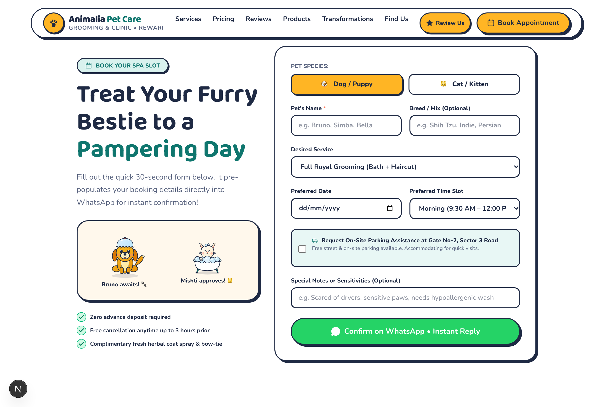

### 🔍 UI/UX Explanation (Hinglish):
* **Frictionless Form Design:** Lambe boring forms ki jagah visually pleasing sticker inputs:
  1. **Pet Species Toggle:** `🐶 Dog / Puppy` vs `🐱 Cat / Kitten`
  2. **Pet's Name & Breed:** Clean single-line inputs
  3. **Desired Service Dropdown:** Pre-populated options
  4. **Date & Preferred Time Slot:** Morning (9:30 AM – 12:00 PM), Afternoon, ya Evening slots
  5. **Parking Assistance Checkbox:** *"Request On-Site Parking Assistance at Gate No-2, Sector 3 Road"*
  6. **Special Sensitivities:** E.g., *"Scared of loud sounds"*
* **High-Converting WhatsApp CTA:** `Confirm on WhatsApp • Instant Reply` — Form submit hote hi instant pre-filled WhatsApp message ban kar send ho jata hai.
* **Zero Risk Promises:**
  * ✅ Zero advance deposit required
  * ✅ Free cancellation up to 3 hours prior
  * ✅ Complimentary fresh herbal coat spray & bow-tie bandana

---

## 15. 📍 Location, Map & Directions (Rewari Centre)

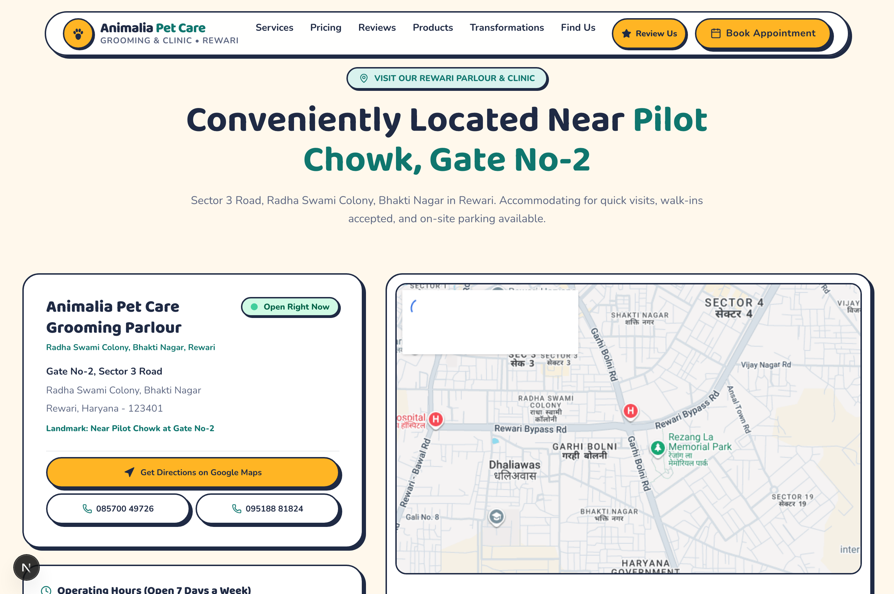

### 🔍 UI/UX Explanation (Hinglish):
* **Precise Landmark Callout:** *"Conveniently Located Near Pilot Chowk, Gate No-2"* (Sector 3 Road, Radha Swami Colony, Bhakti Nagar, Rewari, Haryana - 123401).
* **Direct Clicks:**
  * `Get Directions on Google Maps` (Opens native navigation app with GPS coordinates).
  * Direct Tap-to-call phone numbers: `📞 085700 49726` aur `📞 095188 81824`.
* **Interactive Map Card:** Surrounding area map show karta hai jisse local pet parents ko reach karne me koi confusion na ho.

---

## 16. 📱 In-Store Counter QR Code Standee (`/review-qr`)

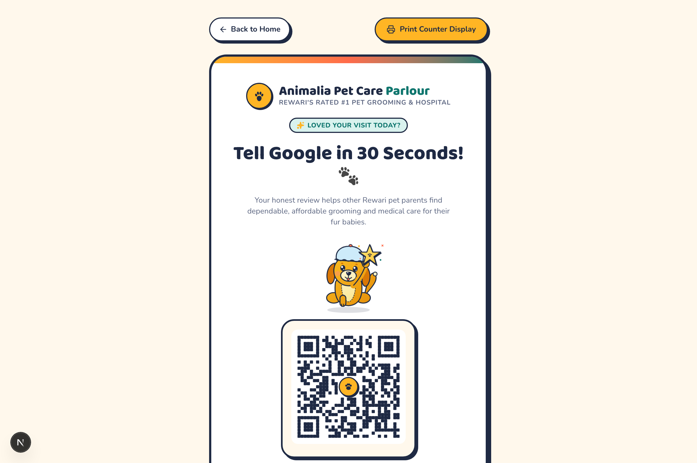

### 🔍 UI/UX Explanation (Hinglish):
* **Dedicated In-Clinic Page (`/review-qr`):** Yeh screen parlour ke reception counter tablet par open ki ja sakti hai ya print karke acrylic standee me lagayi ja sakti hai.
* **Headline:** *"Loved your visit today? Tell Google in 30 Seconds!"*
* **High-Contrast Paw QR Code:** Customer apne camera se scan karta hai aur turant Google Maps review screen khul jati hai. Counter staff ko review mangne me awkward nahi hona padta!
* **Print Button:** `Print Counter Display` button se clean A4/A5 standee layout me print nikal jata hai.

---

## 17. 📲 Mobile Responsive Experience & Sticky Bottom Bar

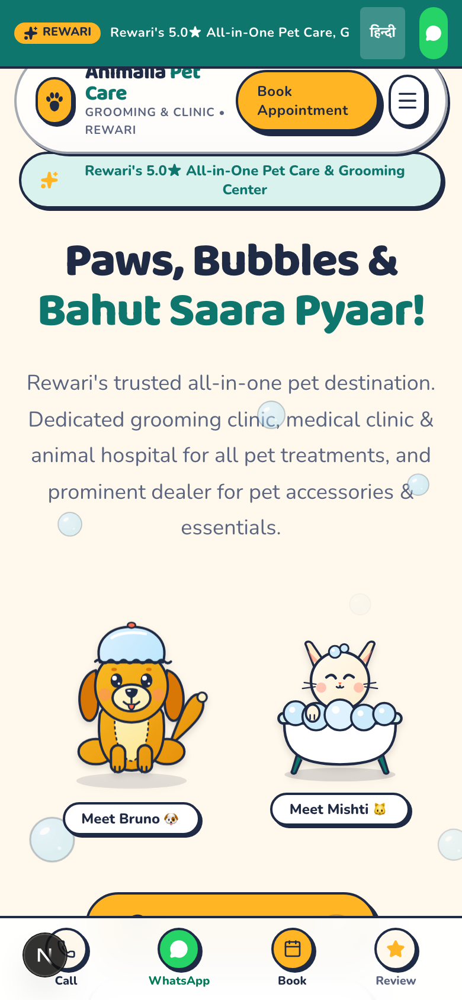

### 🔍 UI/UX Explanation (Hinglish):
85%+ pet parents mobile se website visit karte hain, isliye mobile UX par special focus diya gaya hai:
* **One-Handed Thumb Zone Navigation:**
  * Screen ke bottom me **Persistent Sticky Action Bar** rehta hai:
    1. 📞 **Call:** Direct emergency & reception phone dialer
    2. 💬 **WhatsApp:** Instant chat & enquiry
    3. 📅 **Book:** 1-tap scroll to appointment form
    4. ⭐ **Review:** Quick 5-star Google review trigger
* **Finger-Friendly Touch Targets:** Har button aur chip ki minimum height 48px rakhi gayi hai jisse accidental miss-clicks na hon.
* **Fast Lightweight Layout:** Zero heavy video backgrounds, responsive SVG illustrations aur optimized Next.js WebP images.

---

## 18. 🎯 Key UX Takeaways & Conversion Checklist

| Feature | UX Goal | Target Metric |
| :--- | :--- | :--- |
| **Pulsing Live Open Status** | Customer ko instant batana ki parlour khula hai ya nahi | Call bounce rate reduction |
| **Bilingual Toggle (EN/HI)** | Local Haryana/Rewari users ke liye comfortable browsing | User engagement & readability |
| **Weight-based Pricing Calculator** | No-surprise upfront transparency | High trust & conversion |
| **Review Generation Stepper** | Customer ka typing effort zero karna | 40+ se 150+ 5-star reviews on Google |
| **WhatsApp-integrated Cart & Booking** | No credit card friction, fast local Indian conversion | 3x faster lead generation |
| **Counter Standee QR Page** | Checkout ke waqt customer se on-spot review lena | In-store review conversion rate |

---

*Doc created with ❤️ for Animalia Pet Care Rewari Team.*

